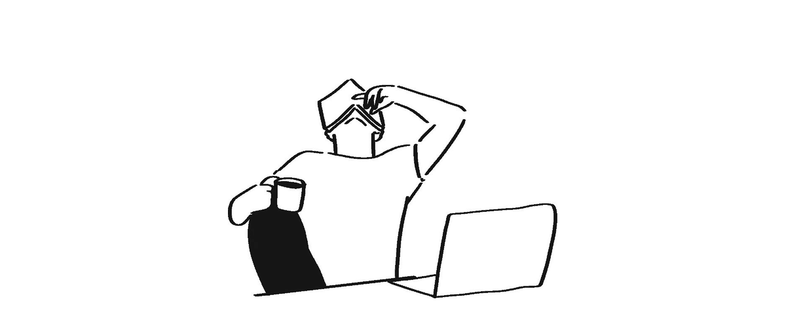
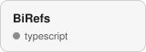
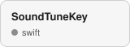
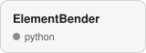
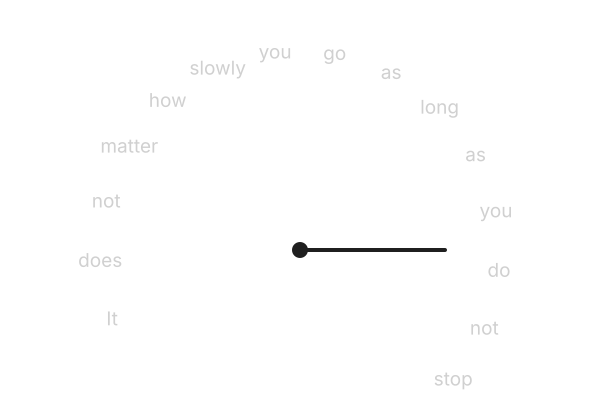

<picture>
  <source media="(prefers-color-scheme: dark)" srcset="assets/title-dark.svg">
  
</picture>

<picture>
  <source media="(prefers-color-scheme: dark)" srcset="assets/banner-dark.gif">
  
</picture>

 

## tech stack

<!-- skills:start -->
<picture><source media="(prefers-color-scheme: dark)" srcset="assets/windows.svg"></picture>&nbsp;&nbsp;
<picture><source media="(prefers-color-scheme: dark)" srcset="https://cdn.simpleicons.org/apple/BFBFBF"></picture>&nbsp;&nbsp;
<picture><source media="(prefers-color-scheme: dark)" srcset="https://cdn.simpleicons.org/linux/BFBFBF"></picture>&nbsp;&nbsp;
<picture><source media="(prefers-color-scheme: dark)" srcset="https://cdn.simpleicons.org/git/BFBFBF"></picture>&nbsp;&nbsp;
<picture><source media="(prefers-color-scheme: dark)" srcset="assets/vscode.svg"></picture>&nbsp;&nbsp;
<picture><source media="(prefers-color-scheme: dark)" srcset="https://cdn.simpleicons.org/postman/BFBFBF"></picture>&nbsp;&nbsp;
<picture><source media="(prefers-color-scheme: dark)" srcset="https://cdn.simpleicons.org/javascript/BFBFBF"></picture>&nbsp;&nbsp;
<picture><source media="(prefers-color-scheme: dark)" srcset="https://cdn.simpleicons.org/openjdk/BFBFBF"></picture>&nbsp;&nbsp;
<picture><source media="(prefers-color-scheme: dark)" srcset="https://cdn.simpleicons.org/html5/BFBFBF"></picture>&nbsp;&nbsp;
<picture><source media="(prefers-color-scheme: dark)" srcset="https://cdn.simpleicons.org/python/BFBFBF"></picture>&nbsp;&nbsp;
<picture><source media="(prefers-color-scheme: dark)" srcset="https://cdn.simpleicons.org/css/BFBFBF"></picture>&nbsp;&nbsp;
<picture><source media="(prefers-color-scheme: dark)" srcset="https://cdn.simpleicons.org/typescript/BFBFBF"></picture>&nbsp;&nbsp;
<picture><source media="(prefers-color-scheme: dark)" srcset="https://cdn.simpleicons.org/gnubash/BFBFBF"></picture>
<!-- skills:end -->

## playing

<picture>
  <source media="(prefers-color-scheme: dark)" srcset="https://raw.githubusercontent.com/ppdrada/ppdrada/output/pacman-contribution-graph-dark.svg">
  
</picture>

## latest things i built

<!-- repos:start -->
<a href="https://github.com/ppdrada/BiRefs"><picture><source media="(prefers-color-scheme: dark)" srcset="assets/repo-BiRefs.svg"></picture></a>&nbsp;<a href="https://github.com/ppdrada/SoundTuneKey"><picture><source media="(prefers-color-scheme: dark)" srcset="assets/repo-SoundTuneKey.svg"></picture></a>&nbsp;<a href="https://github.com/ppdrada/it-assistant"><picture><source media="(prefers-color-scheme: dark)" srcset="assets/repo-it-assistant.svg"></picture></a>&nbsp;<a href="https://github.com/ppdrada/no-leaks-secret-santa"><picture><source media="(prefers-color-scheme: dark)" srcset="assets/repo-no-leaks-secret-santa.svg"></picture></a>&nbsp;<a href="https://github.com/ppdrada/ElementBender"><picture><source media="(prefers-color-scheme: dark)" srcset="assets/repo-ElementBender.svg"></picture></a>
<!-- repos:end -->

<picture>
  <source media="(prefers-color-scheme: dark)" srcset="speedometer.svg">
  
</picture>

