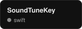
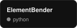
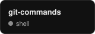
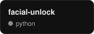
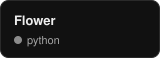
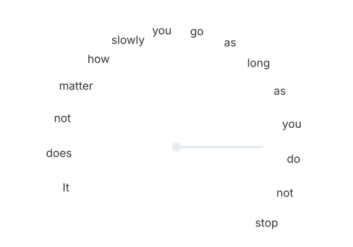

<picture>
  <source media="(prefers-color-scheme: dark)" srcset="assets/title-dark.svg">
  
</picture>

<picture>
  <source media="(prefers-color-scheme: dark)" srcset="assets/banner-dark.gif">
  
</picture>

 

## tech stack

<!-- skills:start -->
&nbsp;&nbsp;
&nbsp;&nbsp;
&nbsp;&nbsp;
&nbsp;&nbsp;
&nbsp;&nbsp;
&nbsp;&nbsp;
&nbsp;&nbsp;
&nbsp;&nbsp;
&nbsp;&nbsp;

<!-- skills:end -->

## playing

<picture>
  <source media="(prefers-color-scheme: dark)" srcset="https://raw.githubusercontent.com/ppdrada/ppdrada/output/pacman-contribution-graph-dark.svg">
  
</picture>

## latest things i built

<!-- repos:start -->
&nbsp;&nbsp;&nbsp;&nbsp;
<!-- repos:end -->

